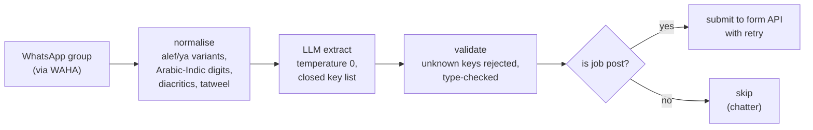

# WhatsApp job post extractor

An n8n workflow that reads messages from a WhatsApp group, skips the chatter,
pulls the job posts into structured JSON with an LLM, validates that JSON
against a closed schema, and submits it to a form API.

Built for UAE film and TV job groups, so it handles English, Gulf Arabic and
Arabizi (Arabic typed in Latin letters and digits, "matloob 2 PA's, 800/yom").

It runs with one click and no API key.

```
$ python3 eval.py
exact match on every expected field: 15/15 (100%)

per field accuracy
  is_job_post           15/15  100%
  post_type             15/15  100%
  location_canonical    12/12  100%
  pay_amount            12/12  100%
  pay_currency           9/9   100%
  pay_unit               9/9   100%
  language_detected     12/12  100%
  production_type        1/1   100%
```

## Tech stack

- **Workflow engine:** n8n, 8 nodes, self-contained
- **Language:** Python 3.9+, standard library only — mocks and eval harness
  both have zero dependencies
- **CI:** GitHub Actions — ruff, and `eval.py` across Python 3.9 through 3.13,
  gated on exact field match

## Architecture



## Measurable results

- **15/15 exact field match** on the goldset — `eval.py`, shown above
- **12/15 submitted, 3 correctly skipped as chatter** — verified through the
  real n8n engine, not just the Python harness (see
  [Demo output](#demo-output))
- **0 lint findings** — `ruff check .`
- **CI matrix:** 3.9, 3.10, 3.11, 3.12, 3.13, all green

## Run it

```
npm install -g n8n
python3 mocks/server.py &            # mock LLM + mock form API, no key needed
n8n import:workflow --input=workflow.json
n8n execute --id=whatsappjobextract1
curl localhost:8111/api/job-posts    # 12 of 15 submitted, 3 skipped as chatter
```

Or open n8n in the browser, import `workflow.json`, and press Execute.

For real runs, change two URLs in the workflow: the LLM node to your provider,
the submit node to the real form API.

## Demo output

Run end to end against a real n8n install, not just `eval.py`'s own harness:

```
$ n8n import:workflow --input=workflow.json
Successfully imported 1 workflow.

$ n8n execute --id=whatsappjobextract1
...finished: true

$ curl -s localhost:8111/api/job-posts | python3 -c "import json,sys; print(json.load(sys.stdin)['count'])"
12
```

12, matching the README's own claim exactly. Finding this out caught a real
bug in `workflow.json`: current n8n (1.97.1) requires an explicit `"active"`
key on import and rejects the file without one, which this workflow didn't
have. Fixed by adding `"active": false`.

The workflow's canvas is a real browser GUI, and unlike the health-check and
curl-based demos in this project's sibling repos, there's no way to reach it
headlessly: n8n gates its UI behind a mandatory first-run owner-account form
that a static screenshot can't submit. Import and execute it yourself with
the commands above, or open `http://localhost:5678` after `n8n start` to see
the canvas directly.

## The pipeline

```
WhatsApp (WAHA)  ->  normalise  ->  LLM extract  ->  validate  ->  is job post?
                                                                   |        |
                                                            submit API    skip
```

**normalise** unifies alef and ya variants, Arabic-Indic digits, diacritics and
tatweel. The same word written three ways is three different words to a
matcher, and this is where most Arabic pipelines quietly lose recall.

**LLM extract** runs at temperature 0 with `response_format: json_object` and a
prompt that lists the only permitted keys.

**validate** rejects unknown keys rather than dropping them. A model inventing
a field has misunderstood the contract, and discarding it silently hides the
drift instead of surfacing it. Type checks on every field.

**is job post** routes. Chatter goes to a no-op, job posts go to the API with
retry on failure.

## What the eval caught

The extraction scored 12/15 on the first run. All three failures were the kind
you would never find by reading a few messages and nodding:

| message | bug |
| --- | --- |
| "actor 25-35 ... AED 2500/day" | pay extracted as **35**. It read the age range. |
| "Casting kids ... **Pa**rent**s** must attend" | classified as equipment, because "rent" substring-matched inside "Parents". |
| "للإيجار: كاميرا سوني FX6" | missed entirely. The text was normalised but the keyword list was not, so every Arabic keyword stopped matching. |

A fourth appeared after the first fix: an Arabic post containing "FX6" was
being called mixed-language and routed down the wrong branch, because any
Latin character counted as evidence. Language detection now goes by which
script holds the majority of the letters.

That is the argument for the harness. None of those four are visible from
eyeballing output.

## Why the mock

`mocks/server.py` is an OpenAI-compatible endpoint that returns the structured
JSON a real model would, derived by rules so it is deterministic. A demo that
needs an API key is a demo that stops working, and a test whose numbers move
between runs cannot be used to show a change helped.

Point the LLM node at a real provider and nothing else changes.

## Risks worth naming

**WAHA and similar gateways are unofficial.** They drive WhatsApp Web and are
against WhatsApp's terms. The realistic consequence is the number being
banned, which falls on whoever owns it. Options are to accept that with a
dedicated number, or use the official WhatsApp Business API, which does not
expose arbitrary group messages and so does not solve this problem. Worth
deciding deliberately rather than discovering later.

**OCR.** Plenty of job posts in these groups are screenshots. Not handled here.

**The gold set is the work.** Fifteen messages are enough to prove the harness.
Forty real ones from the actual group, labelled by someone who reads Arabic, is
what makes the numbers mean anything.

## Files

```
workflow.json        the n8n workflow, 8 nodes, self contained
schema.json          the closed output contract
samples/             15 messages: English, Arabic, Arabizi, plus chatter
mocks/server.py      mock LLM and mock form API, standard library only
eval.py              the test report
```

## License

MIT.
